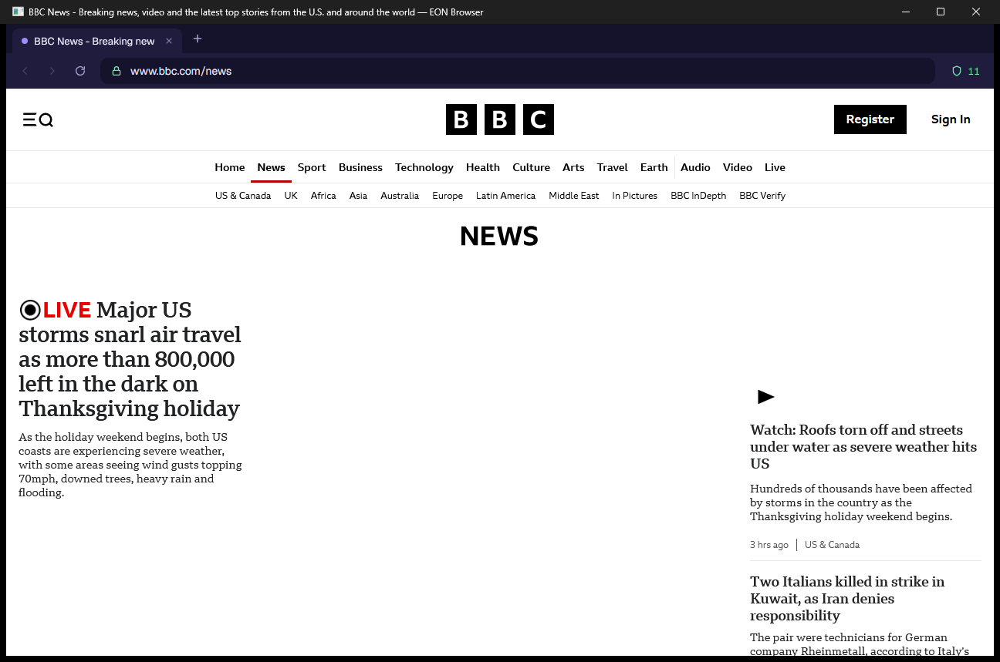

<!--
SPDX-License-Identifier: GPL-3.0-or-later
SPDX-FileCopyrightText: 2026 EON contributors
-->

# EON Browser

A web browser on **Servo**, the open engine written in Rust — not Chromium, not a system
webview (plan madde 50). Blocking built in, no telemetry, no AI, and no request at all
until you open a page. Windows, Linux and macOS. **Early alpha.**



## What it does

- **Ads, trackers and cookie notices blocked** with EasyList, EasyPrivacy and uBlock
  Origin's lists, through Brave's `adblock` engine in
  [`eon-browser-core`](https://github.com/EON-Extensible-Open-Network/eon-browser-core).
  The lists ship inside each release, so the first start makes no request.
- **Clean links**: tracking parameters (`utm_*`, `fbclid`, `gclid`, …) removed and redirect
  wrappers (`google.com/url`, `l.facebook.com`) skipped — in every window, not only a
  "strict" mode.
- **HTTPS-only**: every site over HTTPS; if a site has none, you decide for that site.
- **No search engine chosen for you**, no suggestions sent while you type (history
  suggestions come from your own computer), Global Privacy Control sent, Firefox ESR's user
  agent so you are one of many.
- Tabs, history with full-text search in the address bar, a private window that writes
  nothing (`Ctrl+Shift+N`), the last session restored.
- **The route**: directly, **through Tor** (Arti, the Tor Project's Rust Tor, inside the
  browser: a circuit per site, renewed every ten minutes, New identity with
  `Ctrl+Shift+U`, `.onion` addresses), or through a proxy server you bring. Tor hides your
  address; it does not make you as hard to recognise as Tor Browser does, and the route
  page says so.

- **Extensions from Chrome, Edge, Opera and Firefox**, stage 1:
  `eon-browser --install-extension <file.crx | file.xpi | folder>` shows what the extension
  may do and installs it; its blocking rules (`declarativeNetRequest`) run in the shield,
  its content scripts and styles run in pages. The real uBlock Origin Lite runs 117,636 of
  its rules. Settings pages, pop-ups and background work come next
  ([the stages](https://github.com/EON-Extensible-Open-Network/eon-docs/blob/main/browser/extensions.md)).

## What it does not do yet

**Not sandboxed on Windows** (Servo does not yet isolate pages the way Chrome and Firefox
do) — not for banking yet. **No video or audio** yet, **no DRM** ever. Some sites
break. No bookmarks bar, downloads, permission prompts or sync yet; extensions are at their first stage. The roadmap
is [`eon-docs/browser/plan.md`](https://github.com/EON-Extensible-Open-Network/eon-docs/blob/main/browser/plan.md).

## How it is built

One Servo instance draws two views into the window: **the bar** (HTML/CSS/JS in `src/ui/`,
compiled into the program) and **the page**. The bar talks to the browser only through
`https://ui.eon.invalid/cmd`, a host that never resolves; pages cannot reach it. The
browser's own pages live on `https://page.eon.invalid/` and their links act only when the
page asking is itself one of them, so no site can change a setting.

```
eon-browser [address]          the window: the last session, or the address
eon-browser --private          a private window: nothing written to disk
eon-browser --selftest <file>  the promises, checked offscreen with the real engine; no network
```

Data lives in `eon-browser-data/` beside the executable (`EON_BROWSER_DATA` overrides).

The route is a second program, `eon-browser-route`, beside the browser: a proxy on
`127.0.0.1` that answers only to a secret the browser gives it at start, and that exits
when the browser does. It is built separately (`cargo build -p eon-browser-route`):
Arti and Servo cannot share one feature-unified build (see `route/Cargo.toml`).

## Checks

`cargo test`, and `--selftest`: 37 checks through the real engine against pages the
browser serves itself — blocking, element hiding, link cleaning, HTTPS-only, the user agent,
GPC, keyboard (Turkish letters) and wheel input, the bar, the own pages, and that a site
can neither reach the bar's bridge nor choose your search engine. Emptying the rules makes
six of them fail, as they should.

## Licence

`GPL-3.0-or-later` with the EON Module ABI Exception. Servo and `adblock` are MPL-2.0.
Geist is OFL-1.1.
